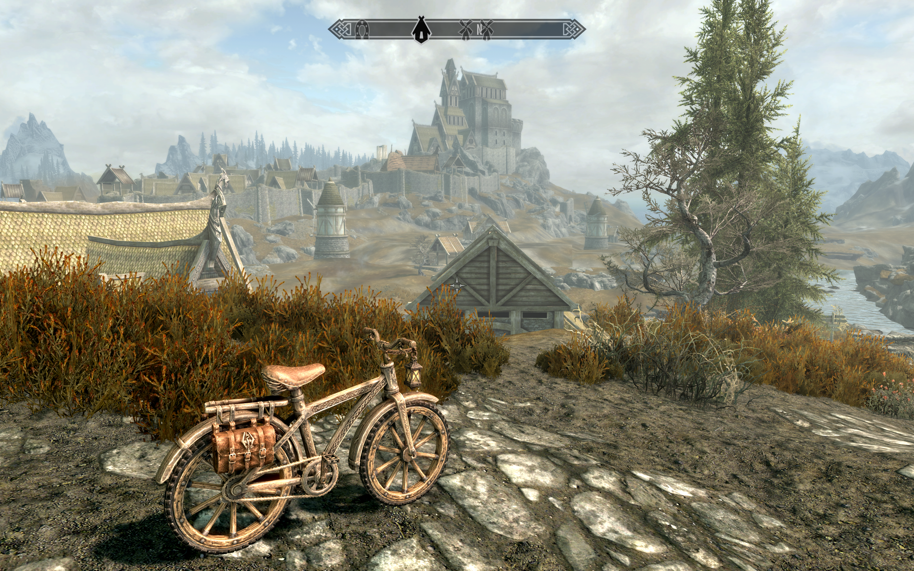
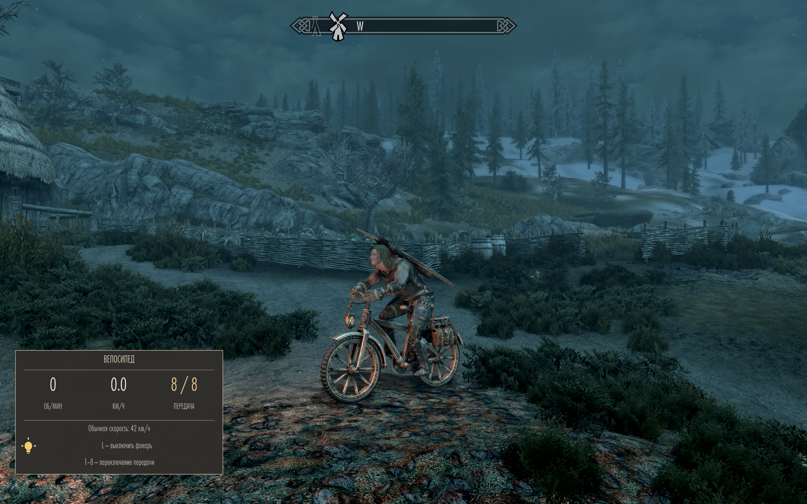
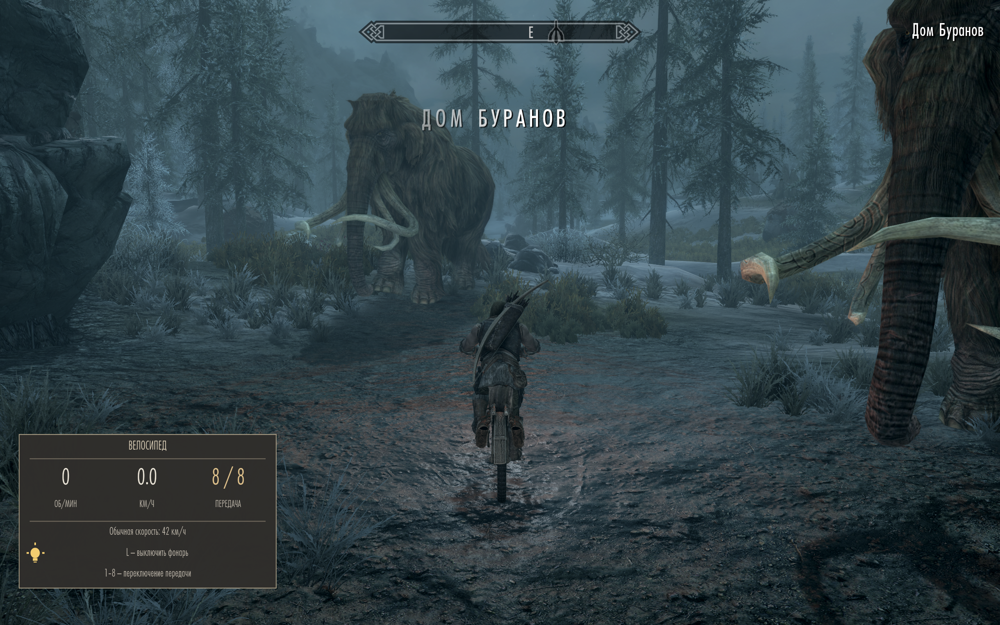

# C3 Skyrim Cycle — Rideable Bicycle

By **AndreiProrva** · Keyboard edition **0.1.25** · Windows x64

A rideable, Skyrim-styled bicycle with animated pedalling, eight gears,
a warm switchable headlamp, wheel audio and an in-game cycling display.

## Features

- Custom bicycle assembled from individually generated Meshy AI components.
- Animated wheels and pedals; rider legs follow the crank, including turns.
- Eight gears: normal forward targets **14 / 18 / 22 / 26 / 30 / 34 / 38 / 42 km/h**.
- HUD: animation RPM, actual game speed, selected gear, lamp status and key hints.
- Warm amber headlamp with forward illumination, toggled with **L**.
- Bicycle start/rolling audio, modest cadence-dependent pitch and a fade at rest.
- Bicycle-specific rider and sound handling; normal horses retain their own behaviour.
- Mount/dismount support and a parked bicycle that remains available after dismounting.

This release is the keyboard-controlled game mod. BLE cadence sensors,
exercise-bike power measurement, automatic routes and workout charts are not
included. HUD RPM describes the in-game animation, not a real sensor reading.
Speed uses an approximate conversion of 70 game units per metre; it is a game
measurement rather than a calibrated physical simulation. Shift can exceed
the listed normal gear speeds. The HUD in this release uses Russian labels.

## Requirements

Tested together on one Windows PC:

| Component | Required version |
|---|---|
| Skyrim Special Edition / Anniversary Edition, Steam | **1.7.104.0**, 64-bit |
| [SKSE](https://skse.silverlock.org/) | **2.3.1** |
| [Address Library for SKSE Plugins](https://www.nexusmods.com/skyrimspecialedition/mods/32444) | All-in-one AE, **v13** tested |
| Microsoft Visual C++ x64 runtime | Current supported v14 redistributable |

The native plugin deliberately accepts only the game/SKSE versions above.
Older SE/AE, VR, GOG and console editions are unsupported by this binary.
Python, Blender, Meshy, FNIS and Nemesis are not required to play this release.
No external bicycle hardware is needed.

## Install and play

See [the complete English guide](INSTALL_EN.md) or
[подробную инструкцию на русском](INSTALL_RU.md).
Install the runtime ZIP in MO2 or Vortex, enable `C3SkyrimCycle.esp`, and launch
the matching SKSE loader. The bicycle is added through the console; it is not
automatically placed in the world.

| Key | Action |
|---|---|
| E | Mount / dismount, with default Skyrim activation binding |
| W / S | Forward / backward |
| A / D | Turn |
| Shift | Accelerate |
| 1–8, top number row | Select gear |
| L, also physical Д key on Russian layout | Toggle headlamp |

## Compatibility and limitations

The mod uses the game's mount framework, a separate bicycle actor/race,
custom skeleton/model and scoped native rider corrections. It does not
replace the global horse model or global horse/rider animation files.
It is not a complete replacement of Skyrim's vehicle physics.
Other mods that change mounted player animation, camera, skeletons, inputs
or mount behaviour may conflict. Custom body proportions and high-heel
footwear have not been comprehensively tested. Third-person use is recommended.

User-tested: riding, gears, rider/pedal contact, turns, Shift, mounting,
dismounting, lamp, bicycle sound and normal horse isolation. Automated pose
and motion checks were also run. This is not a claim of testing every body,
mod list, save or computer.

## Credits and licensing

Full attribution and AI disclosure: [CREDITS.md](CREDITS.md).
Code: GPL-3.0-or-later, with upstream CommonLib notices/exceptions preserved.
Model and game-derived assets have separate terms: [ASSET_LICENSES.md](ASSET_LICENSES.md).
Download the matching corresponding-source archive alongside the binary release.

Release 0.1.25 includes the approved 5 cm foot-height correction. The unchanged
native DLL reports internal version 0.1.24; this is expected.
